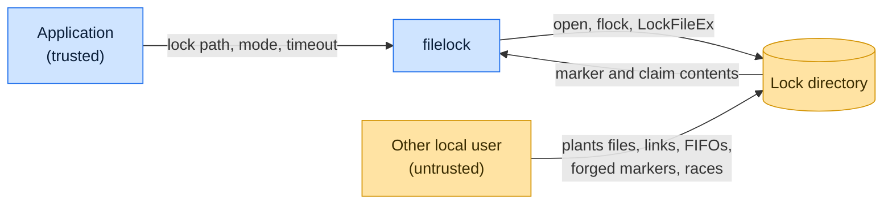

# Threat model

This model says what filelock trusts, where untrusted input enters, and which guarantees hold at each boundary, so a
report can be classified as a vulnerability or a bug. [SECURITY.md](SECURITY.md) covers reporting; if the two disagree,
SECURITY.md wins and we fix this file.

## How filelock works

An application names a lock path. filelock opens or creates that file and locks it with `fcntl.flock` on Unix or
`LockFileEx` on Windows, or, for the soft locks, publishes an `O_CREAT | O_EXCL` marker that records the holder's PID,
host and process start token. `ReadWriteLock` coordinates readers and writers through SQLite transactions on a lock
database. The library makes no network requests and runs no subprocess that takes user input; everything it reads comes
from the filesystem, where other local users may share the lock directory.

## Compared with similar tools

We drew the boundary where comparable projects in other ecosystems draw theirs. The shared rule, stated by the
[Node.js threat model](https://github.com/nodejs/node/blob/main/SECURITY.md#the-nodejs-threat-model), is that a report
which first needs a trusted element compromised is out of scope; the first triage question, as
[DOMPurify](https://github.com/cure53/DOMPurify/blob/main/SECURITY.md#what-we-consider-a-vulnerability) puts it, is what
the attacker controls.

| Project                                                                                                         | Language   | Where it draws the line                                                                                                                                                                                    |
| --------------------------------------------------------------------------------------------------------------- | ---------- | ---------------------------------------------------------------------------------------------------------------------------------------------------------------------------------------------------------- |
| [gofrs/flock](https://github.com/gofrs/flock/security/policy)                                                   | Go         | Advisory `flock` wrapper; supports the latest release only and publishes no threat model.                                                                                                                  |
| [Java `FileLock`](https://docs.oracle.com/en/java/javase/21/docs/api/java.base/java/nio/channels/FileLock.html) | Java       | Documents that whether a lock stops another program is system-dependent: advisory, for cooperating processes.                                                                                              |
| [Qt `QLockFile`](https://doc.qt.io/qt-6/qlockfile.html)                                                         | C++        | Treats a lock as stale when its recorded process is gone or, by default, once the file is 30 seconds old; filelock's soft locks break only on proof the owner is gone unless the caller sets a `lifetime`. |
| [pnpm](https://github.com/pnpm/pnpm/security/policy)                                                            | JavaScript | Draws its boundary at filesystem permissions: the store, project, lockfile and configuration are trusted, and running it in a repository means trusting that repository.                                   |

## Trusted

An attacker who controls any of these already has what filelock could give them:

- The calling application and the lock path, `mode` and options it passes.
- Every process running under the holder's user ID; it can rewrite or remove any lock file.
- The operating system, its locking primitives and the filesystem's semantics.
- Directories above the lock's parent. On Windows, the lock directory itself must not be writable by untrusted users.

## Untrusted inputs

| Input                                    | Comes from                                               | What filelock guarantees                                                                                                                                                                                            |
| ---------------------------------------- | -------------------------------------------------------- | ------------------------------------------------------------------------------------------------------------------------------------------------------------------------------------------------------------------- |
| Nodes at the lock path and derived names | Another local user sharing the directory, such as `/tmp` | Opens use `O_NOFOLLOW` on Unix and refuse reparse points on Windows; `lstat` then `fstat` before reading a marker; `O_NONBLOCK` against FIFOs; the `ReadWriteLock` database refuses symlinks and non-regular files. |
| Marker and claim contents                | Another local user, or a crashed holder                  | Unless the caller set a `lifetime`, a holder is judged stale only on proof the recorded owner is gone (fail closed); marker and claim reads stop at 1024 bytes.                                                     |
| Timing                                   | Concurrent processes of any user                         | Markers and claims are created atomically with `O_EXCL` and hard links.                                                                                                                                             |

## Threats and controls

| STRIDE                 | Threat                                                                    | Control                                                                                                           |
| ---------------------- | ------------------------------------------------------------------------- | ----------------------------------------------------------------------------------------------------------------- |
| Spoofing               | A forged marker names a dead PID so a live holder looks stale.            | A marker is broken only when its owner is provably dead: same host, and the PID gone or its start token changed.  |
| Tampering              | A symlink at the lock path redirects truncate or `chmod` to another file. | `O_NOFOLLOW`, reparse-point checks and `fstat` on the opened descriptor.                                          |
| Denial of service      | A planted FIFO or huge marker hangs or exhausts the holder.               | `O_NONBLOCK` opens and 1024-byte record reads; holding the lock itself is accepted (see below).                   |
| Elevation of privilege | A planted `.filelock-*` directory steers a cleanup delete elsewhere.      | The sweep skips symlinks and directories another account owns, and removes only hard links to this lock database. |

## Release chain

Releases run on the shared [tox-dev/github-workflows](https://github.com/tox-dev/github-workflows) pipeline. A release
App, not a person, pushes the release commit and tag; the build installs its tools from a hash-checked `pylock.toml`
resolved with a seven-day upload cooldown by default; PyPI receives the files through
[trusted publishing](https://docs.pypi.org/trusted-publishers/) with attestations, and the GitHub Release is immutable.
Every workflow pins third-party actions to a commit SHA.

## Vulnerability or bug

| Report                                                             | Verdict             | Why                                                                    |
| ------------------------------------------------------------------ | ------------------- | ---------------------------------------------------------------------- |
| Another user's symlink makes the lock truncate `~/.bashrc`         | Vulnerability       | Untrusted node at the lock path reaches a write outside the lock file. |
| Two processes both hold `FileLock` without `lifetime`              | Vulnerability       | Mutual exclusion is the guarantee.                                     |
| `SoftFileLock(lifetime=5)` lets a second holder in after 5 seconds | Bug or expected     | Documented overlap the caller opted into.                              |
| A process of the same user deletes the lock file                   | Not a vulnerability | Same-user processes are trusted.                                       |
| Another user holds the lock forever                                | Vulnerability, Low  | Expected of an advisory lock in a shared directory.                    |

## Severity

- **High:** another local user makes the lock open, create, truncate, `chmod`, rename or delete a file other than the
  lock file, or two processes hold the same exclusive lock with no `lifetime`, lease expiry or `on_compromise` signal.
- **Medium:** another user reads data through the lock, a lock file ends up writable by others despite a restrictive
  `mode`, or crafted contents or a planted node crash, hang or exhaust the holder.
- **Low:** a local user who can write the lock directory holds or pre-creates the lock and delays others.

## Accepted risks

- `StrictSoftFileLock` never reclaims a crashed holder's claim by itself; recovery needs `force_break`.
- Network filesystems may not honor `flock` across clients.

## Keeping this current

Revisit this model when filelock gains a new input source, network access, a new way to run code, or a new place it
writes to, and whenever an advisory is published.
